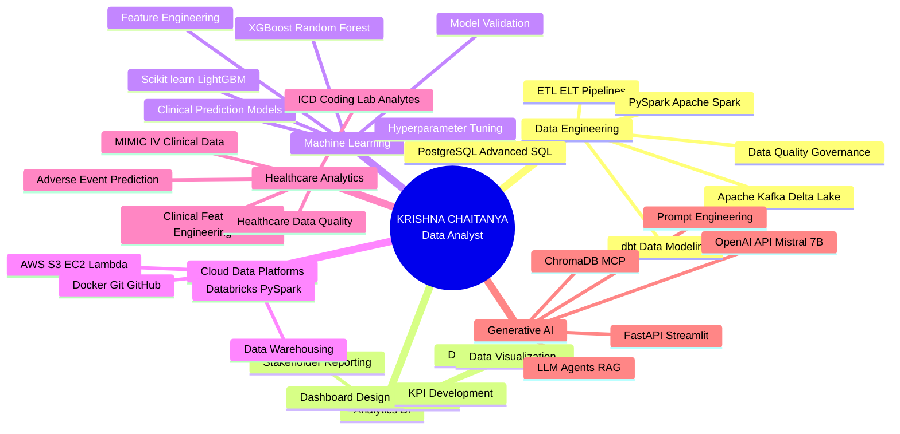
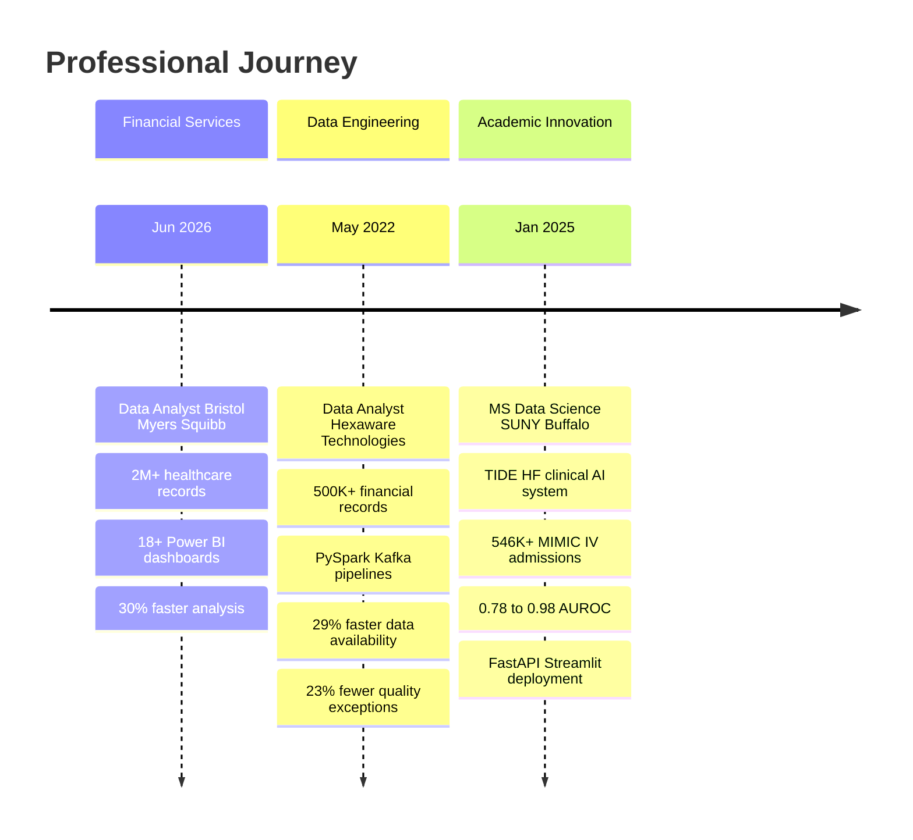
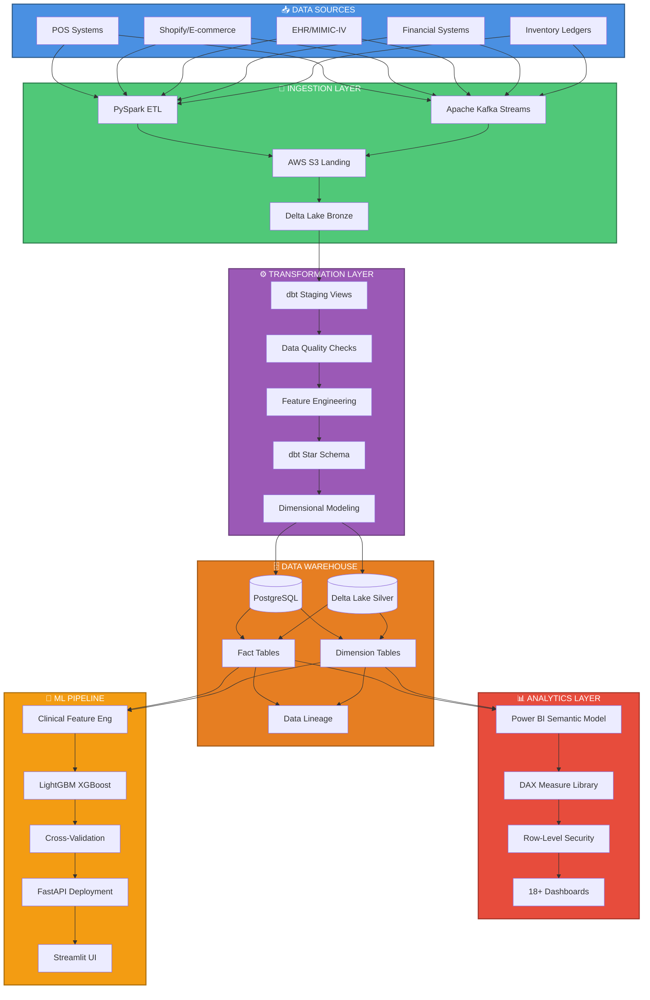

  
  
   
  
  
  
  
  
  
   
  
  ### 🎯 Data Analyst | Analytics Engineer | Clinical AI Architect
  
  

    <em>Transforming complex healthcare, financial, and operational data into actionable intelligence through advanced analytics, machine learning, and production-grade data infrastructure</em>
  

  
   
  
  
  

---

## 📊 **EXECUTIVE SUMMARY**

Data Analyst with **3+ years of enterprise experience** architecting end-to-end analytics solutions across **financial services**, **healthcare**, and **operational domains**. Proven expertise in designing **clinical AI pipelines** (TIDE-HF: 546K+ admissions, 0.78–0.98 AUROC), building **governed data warehouses** (500K+ records, 29% faster availability), and delivering **stakeholder-ready dashboards** (18+ Power BI reports, 30% faster analysis).

**Core Value Proposition:**
- **Clinical Analytics Innovation**: Architected TIDE-HF, a production-grade heart failure prediction system processing 137K clinical visits with multi-label ML achieving research-grade performance
- **Enterprise Data Engineering**: Designed PySpark/Kafka pipelines reducing data quality exceptions by 23% and processing time by 17% across 500K+ financial records
- **Governed Analytics Infrastructure**: Built dbt star schemas, DAX measure libraries, and RLS-scoped Power BI solutions translating raw data into executive-ready insights
- **Cross-Functional Leadership**: Partner with 20+ stakeholders across Finance, Ops, and Clinical teams to define KPIs, validate business logic, and deliver scalable analytics

**Technical Differentiators:**
- **Full-Stack Analytics**: SQL → Python → PySpark → dbt → Power BI → Machine Learning
- **Production ML Deployment**: FastAPI + Streamlit + RAG (Mistral 7B + ChromaDB + MCP)
- **Data Governance Expert**: Data quality, validation, lineage, reconciliation, and metric governance
- **Healthcare Domain**: MIMIC-IV clinical datasets, ICD coding, lab analytes, adverse-event prediction

---

## 🗺️ **TECHNICAL ARCHITECTURE & EXPERTISE MAP**

---

## 💼 **CAREER TIMELINE & IMPACT EVOLUTION**

---

## 🏗️ **END-TO-END DATA PIPELINE ARCHITECTURE**

---

## 🎯 **CLINICAL AI SYSTEM ARCHITECTURE: TIDE-HF**

```mermaid
graph LR
    subgraph Data["📊 MIMIC-IV Clinical Data"]
        A1[546K+ Admissions]
        A2[60+ ICD Codes]
        A3[70+ Lab Analytes]
        A4[137K Analytical Visits]
    end
    
    subgraph ETL["🔄 Clinical ETL Pipeline"]
        B1[ICD Code Mapping]
        B2[Lab Value Extraction]
        B3[Temporal Alignment]
        B4[Data Quality Validation]
        B5[Feature Engineering]
    end
    
    subgraph Features["⚙️ Feature Engineering"]
        C1[108 Clinical Features]
        C2[Vital Signs]
        C3[Lab Trends]
        C4[Medication History]
        C5[Comorbidity Scores]
    end
    
    subgraph ML["🤖 Multi-Label ML"]
        D1[11 LightGBM Classifiers]
        D2[Cross-Validation]
        D3[Hyperparameter Tuning]
        D4[0.78-0.98 AUROC]
    end
    
    subgraph Deploy["🚀 Production Deployment"]
        E1[FastAPI Backend]
        E2[Streamlit UI]
        E3[RAG: Mistral 7B]
        E4[ChromaDB Vector Store]
        E5[MCP Protocol]
    end
    
    A1 & A2 & A3 --> A4
    A4 --> B1 & B2 & B3
    B1 & B2 & B3 --> B4 --> B5
    B5 --> C1 --> C2 & C3 & C4 & C5
    C2 & C3 & C4 & C5 --> D1 --> D2 --> D3 --> D4
    D4 --> E1 --> E2
    E1 --> E3 --> E4 --> E5
    
    style Data fill:#4A90E2,stroke:#2E5C8A,stroke-width:2px,color:#fff
    style ETL fill:#50C878,stroke:#2E7D4E,stroke-width:2px,color:#fff
    style Features fill:#9B59B6,stroke:#6A3D7C,stroke-width:2px,color:#fff
    style ML fill:#E67E22,stroke:#A05A1A,stroke-width:2px,color:#fff
    style Deploy fill:#E74C3C,stroke:#A33327,stroke-width:2px,color:#fff
```

---

## 🛠️ **COMPREHENSIVE TECHNOLOGY STACK**

### **💾 Data Engineering & Warehousing**

### **📊 Analytics & Business Intelligence**

### **🤖 Machine Learning & AI**

### **☁️ Cloud & DevOps**

![Docker](https://img.shields.io/badge/Docker-2496ED?style=for-the-badge&logo=docker&